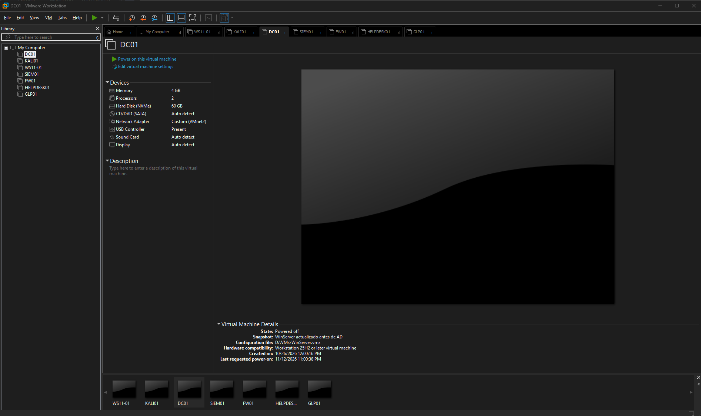
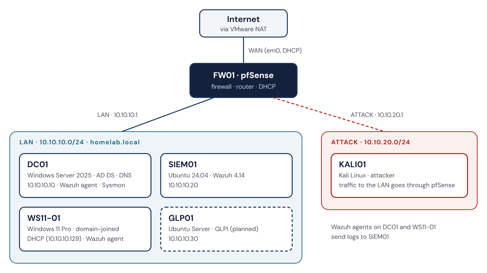
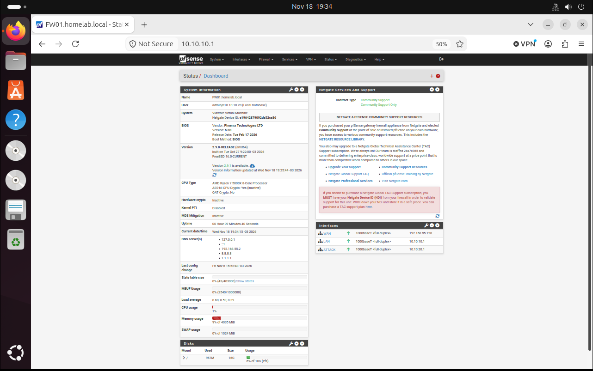
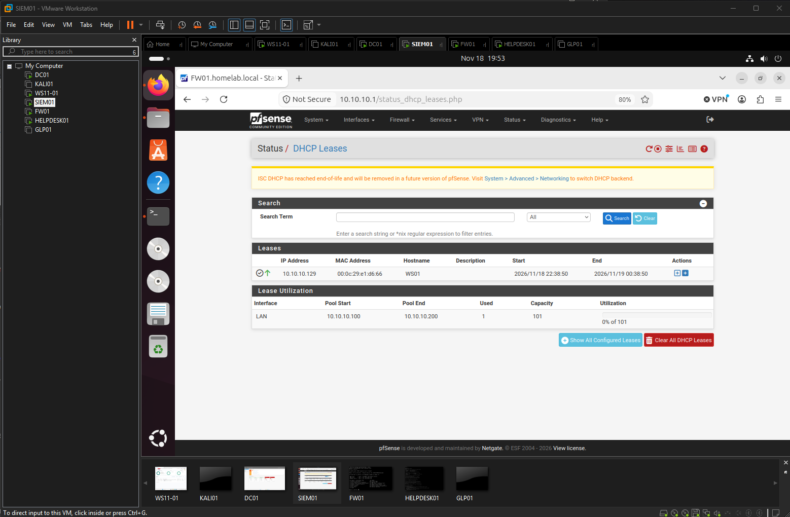
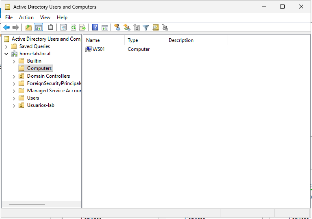
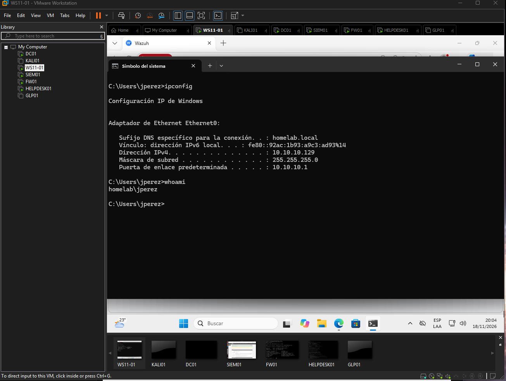
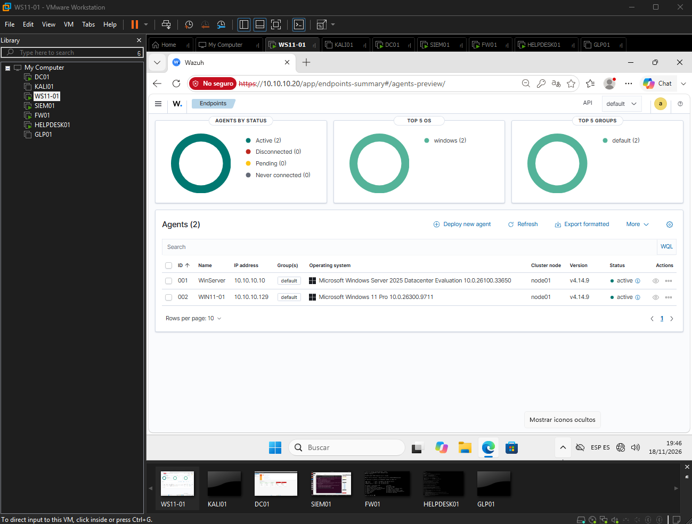
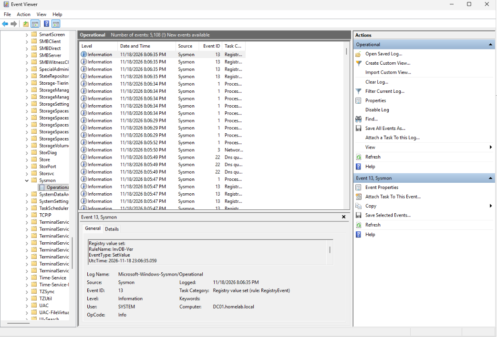
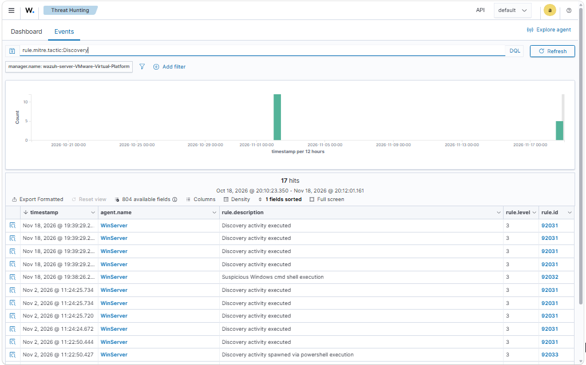

# Security Home Lab

A small company network I built at home in VMware Workstation to practice IT support and security operations: a firewall, an Active Directory domain and a SIEM. I use it to attack my own machines from Kali Linux, see what gets detected, and write down what I learn.

## Network

| VM | Role | OS | IP |
|---|---|---|---|
| FW01 | Firewall / router, DHCP | pfSense CE 2.9 | 10.10.10.1 |
| DC01 | Domain controller, DNS | Windows Server 2025 | 10.10.10.10 |
| WS11-01 | Domain-joined workstation | Windows 11 Pro | DHCP (10.10.10.100–200) |
| SIEM01 | Wazuh 4.14 (all-in-one) | Ubuntu 24.04 | 10.10.10.20 |
| GLP01 | GLPI ticketing (planned) | Ubuntu Server | 10.10.10.30 |
| KALI01 | Attacker | Kali Linux | ATTACK network (10.10.20.x) |

- **WAN** (em0) goes out through VMware NAT.
- **LAN** (em1) is an isolated VMware network (VMnet2), 10.10.10.0/24. This is the "company" network.
- **ATTACK** is a separate network, 10.10.20.0/24, where KALI01 lives. Any attack against the LAN has to go through pfSense, like an outside attacker hitting a real company.

Host: Ryzen 7 5800X, 64 GB RAM.

## 1. Firewall: pfSense

- Installed pfSense CE on its own VM with two network cards: WAN and LAN.
- Three interfaces: WAN, LAN (10.10.10.1/24) and ATTACK (10.10.20.1/24).
- DHCP on the LAN for clients from .100 to .200, DNS 1.1.1.1 and 8.8.8.8.
- Servers (DC01, SIEM01) use fixed IPs; workstations get theirs from DHCP.

**Problem I hit: two DHCP servers on the same network.** WS11-01 had no default gateway, its DNS suffix was `localdomain` and it wasn't using the domain controller for DNS. `ipconfig /all` showed the lease came from 10.10.10.254, not from pfSense (10.10.10.1): VMware's built-in DHCP was still enabled on VMnet2 and answering first. I turned it off in VMware's Virtual Network Editor, set pfSense's DHCP to hand out DC01 (10.10.10.10) as DNS and `homelab.local` as the domain, and renewed the lease with `ipconfig /release` and `ipconfig /renew`. The client now gets gateway 10.10.10.1 and the domain suffix.

**Problem I hit:** the first install failed. The VM only had 256 MB of RAM and the disk got corrupted. I gave it more memory, recreated the disk and reinstalled.

## 2. Active Directory

- DC01 runs Active Directory and the domain's DNS.
- Domain `homelab.local`, with a custom OU (`Usuarios-lab`) for lab users.
- WS11-01 (hostname WS01) is joined to the domain and signs in with domain users.

**Problem I hit:** after moving DC01 to the new LAN, the client couldn't find the domain. Old DNS records were still pointing to the previous IP. I fixed it with `ipconfig /registerdns` and by restarting the Netlogon service so the DC re-registered its records.

## 3. Monitoring: Wazuh + Sysmon

- Wazuh 4.14 installed all-in-one on SIEM01 (manager, indexer and dashboard).
- Wazuh agents (v4.14.9) on DC01 and WS11-01, both active. In Wazuh they show up by hostname: WinServer and WIN11-01.
- Sysmon on DC01 sending detailed events to Wazuh: process creation (Event ID 1), network connections (3), registry changes (13) and DNS queries (22).

**Problem I hit:** when SIEM01 moved from the NAT network to the LAN (new IP 10.10.10.20), the agents lost contact. I updated the manager address in each agent's config and restarted them until both showed as Active again.

## 4. Attack → detection → response

The goal is to run an attack, check what Wazuh catches, and write down how I'd respond.

| Exercise | Status |
|---|---|
| Reconnaissance commands on DC01. Sysmon + Wazuh raised 17 alerts under MITRE ATT&CK tactic *Discovery*: rules 92031 (Discovery activity executed), 92032 (suspicious cmd execution) and 92033 (discovery via PowerShell) | Done |
| Password spraying from Kali against the domain | Next |
| Sysmon on WS11-01 | Next |

Search used in Wazuh Threat Hunting: `rule.mitre.tactic:Discovery`

## What's next

- Install GLPI on GLP01 and log real tickets for the problems I solve in the lab.
- Password spraying and brute force from Kali, with detection rules in Wazuh.
- A vulnerable web app to attack and monitor.
- Malware analysis in an isolated VM.

---

Agustín Galeano · [LinkedIn](https://www.linkedin.com/in/agustin-galeano-266550448/)
